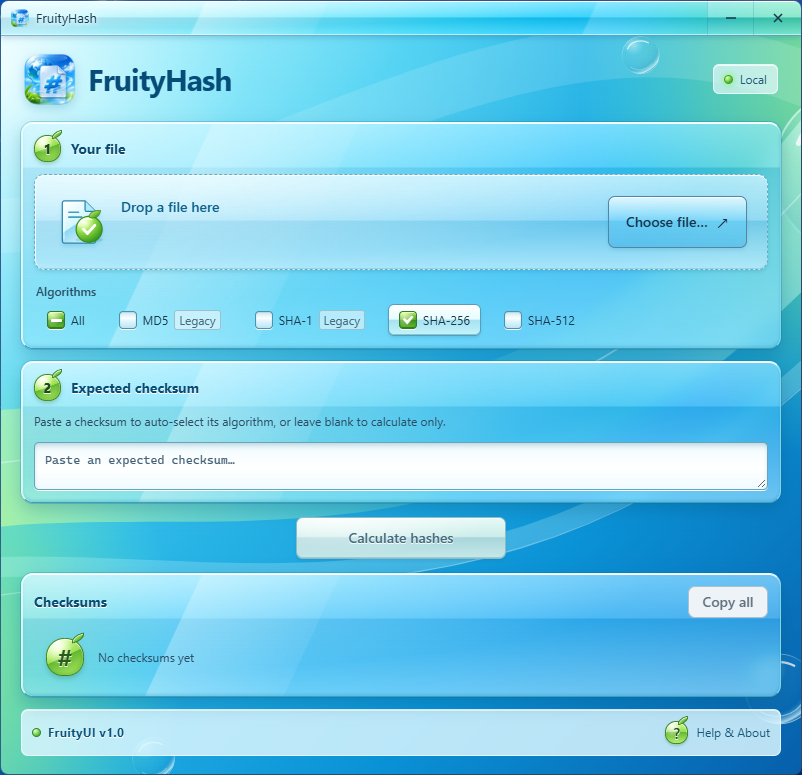

# FruityHash v1.0

An offline desktop checksum utility with **Frutiger Aero** styling.

The idea is simple: small tools for familiar tasks, brought to life with
**Frutiger Aero**. FruityHash does an established job rather than inventing a new
one. Its character comes from glossy glass, watery blues, fresh greens, and the
optimistic desktop aesthetic of Frutiger Aero.

  

  <a href="https://github.com/kapsaloco/FruityHash/releases">Downloads &amp; Releases</a>

Choose or drop a file, calculate its checksums, and compare them with an expected
value. Files stay on your device.

## Features

- MD5, SHA-1, SHA-256, and SHA-512, with SHA-256 selected by default.
- Native file picker and drag-and-drop.
- Progress reporting and cancellation for large files.
- Copy individual checksums or all results.
- Automatic algorithm detection when pasting an expected checksum.
- Keyboard shortcuts and accessible help and confirmation dialogs.

## Usage

1. Open FruityHash and choose or drop one file.
2. Select the algorithms you need. Optionally paste an expected checksum.
3. Click **Calculate hashes** or **Calculate and compare**.
4. Copy the results or review the comparison.

**Ctrl/Cmd+O** opens the file picker. **Escape** cancels an active calculation.

MD5 and SHA-1 are included for legacy compatibility. Prefer SHA-256 for new
checks. A match confirms equality with the supplied checksum; it does not prove
that a file is safe or identify its publisher.

## Privacy

FruityHash works locally without an account or network service. File contents,
paths, and checksums are not uploaded. Selections and preferences are not saved
between sessions.

The Windows app uses the Microsoft Edge WebView2 runtime.

## License

FruityHash and FruityUI are licensed under the [MIT License](LICENSE).
Third-party dependencies retain their own licenses; see
[third-party notices](THIRD_PARTY_NOTICES.txt) for license texts and source links.
